# holdback

[中文](README.zh-CN.md)

holdback keeps personal data and secrets out of what coding agents send to cloud models. Before they leave
your machine, a small on-device model replaces them with numbered placeholders such as `[PRIVATE_EMAIL_2]`.
In the reply, including streamed text and tool-call arguments, holdback puts the real values back. The agent
and your files keep the real values.

It runs in two ways. As a local proxy it redacts every request, for Claude Code started from a terminal, Codex
and any client that speaks the Anthropic Messages, OpenAI Chat Completions or OpenAI Responses API. As hooks
inside Claude Code it redacts what tools return, for sessions that cannot go through a proxy, such as the
Claude desktop app. [Hook mode](#hook-mode-for-the-desktop-app) lists what it does not cover. Version 0.2.

## What it looks like



A recorded run of `holdback run claude` with Claude Haiku. The CSV on disk has real names and emails. The model
provider receives placeholders in the tool result and writes placeholders in its tool call; holdback puts the real
values back, so `welcome.txt` and the answer on screen have them.

## Placeholders instead of masks

Masking every detected value breaks agents. The benchmark has 186 tasks in which the answer depends on a
non-private value next to a private one: a port in a connection string, a date inside an order number, a URL
path. On DeepSeek, Claude Haiku and Qwen, task success was 99.5% with raw text. Replacing what the detector
found with `<REDACTED>` dropped it to 78 to 80%. Numbered placeholders restored in the reply raised it to 88 to
90%. With holdback's rules, which keep hosts, ports, paths, dates and IDs and replace only the secret part, it
reached 100% on all three. [Benchmark](#benchmark) has the full tables and the commands to rerun them, and the
[technical report](docs/report.md) the design behind them and where holdback loses.

## Install

```bash
curl -fsSL https://raw.githubusercontent.com/Daveyuwang/holdback/main/install.sh | sh
```

```bash
holdback setup claude
```

The first command installs one 15 MB binary to `~/.local/bin`, for macOS on Apple silicon or Intel and for
Linux on x86-64 or ARM. The second installs the Claude Code plugin and switches holdback on for every Claude
Code session, in [hook mode](#hook-mode-for-the-desktop-app). With `--proxy` it also sends sessions started
from a terminal through the proxy, which covers more. It saves a copy of your settings file first and prints
how to undo the change.

Both commands finish in about a second. The first session then downloads the model, about 115 MB.
`holdback doctor` checks the installation and names the fix for anything that is wrong.
`sh install.sh --uninstall` removes the binary.

To build from source instead, with Rust 1.88 or later:

```bash
cargo install --git https://github.com/Daveyuwang/holdback holdback
```

The first start downloads holdback's detector to `~/.cache/holdback`: a model of 28M parameters distilled from
OpenAI's [Privacy Filter](https://github.com/openai/privacy-filter) (about 115 MB, Apache-2.0,
[model card](https://huggingface.co/limbo23/holdback-student)). holdback checks each file against a pinned
SHA-256 and keeps only files that match. `HF_ENDPOINT` sends the download to a Hugging Face mirror; on a machine
without network access, `HOLDBACK_STUDENT_DIR` names a folder where you put the model's files yourself.

holdback runs the model with its own code and maps the weight file into memory instead of copying it; the mapped
file counts as file cache, which the system can reclaim. The proxy answers less than 0.05 seconds after it starts,
uses about 40 MB of memory when idle and about 120 MB after long inputs, and adds about 15 ms to a request of 900
characters (`bench/speed.py`). On macOS the matrix math runs on Apple's Accelerate, elsewhere on a portable Rust
library. Homebrew and npm packages are planned.

`HOLDBACK_DETECTOR=privacy-filter` runs the Privacy Filter itself instead, in its 4-bit ONNX form (about 0.9 GB;
`HOLDBACK_MODEL_DIR` names your own copy). It misses fewer values in French, German, Italian, Spanish and Dutch
text. The distilled model misses far fewer in English and Chinese and handles a request 6 to 7 times faster.
[Benchmark](#benchmark) compares the two, and [distill/](distill/README.md) has the code that trains the distilled
model.

## Claude Code

`holdback setup claude` does the steps in this section for you. To do them by hand, start the proxy and
Claude Code together:

```bash
holdback run claude
```

To route every session through holdback, add this to `~/.claude/settings.json`:

```json
{ "env": { "ANTHROPIC_BASE_URL": "http://127.0.0.1:8787/anthropic" } }
```

Then install the plugin. It starts the proxy when a session starts, warns you when a session bypasses the
proxy, and adds `/holdback:status`:

```text
/plugin marketplace add Daveyuwang/holdback
/plugin install holdback@holdback
```

### Hook mode, for the desktop app

The Claude desktop app sends requests to its own API address, so its sessions cannot go through the proxy. With
the plugin installed, hook mode protects them from inside the session. Switch it on in `~/.claude/settings.json`:

```json
{ "env": { "HOLDBACK_HOOKS": "1" } }
```

In hook mode holdback replaces private values in what tools return (files, command output, search results)
before the model sees them. It puts the real values back into what tools receive, such as the files and commands
the model writes, and into the replies shown to you.

Hook mode covers less than the proxy:

- The system prompt, your instruction files and what you type are sent as is. That includes your user name in
  paths and your account email.
- A failed tool call sends its error output as is. Claude Code does not let a hook change it. holdback tells
  you when such output held private values.
- holdback saves the placeholders and their values to `~/.local/state/holdback/values.json`, which only you can
  read. Placeholders stay in the conversation after the local process stops, so a resumed session needs them.
  Proxy mode saves nothing.
- If the `holdback` command is missing, out of date or cannot start, tool calls are denied until that is fixed.

`bench/check_hooks.py` records every request a hook-mode session sends. With Claude Code 2.1.311 on Haiku 5.5,
Sonnet 5.5 and Opus 5.5, no planted value was in any request, and the files the agent wrote held the real values.

## Codex

```bash
holdback run codex
```

This adds a `holdback` model provider that points Codex at the proxy. For another Responses-compatible upstream,
name it and give the environment variable that holds its key:

```bash
export HOLDBACK_UPSTREAMS="bailian=https://<your workspace host>/compatible-mode"
HOLDBACK_KEY_ENV=BAILIAN_API_KEY holdback run codex --upstream bailian -m qwen3.8-flash
```

## Other clients

Set the client's base URL to `http://127.0.0.1:8787/<upstream>`, followed by the provider's own path.

| Upstream name | Forwards to |
| --- | --- |
| `anthropic` | `https://api.anthropic.com` |
| `openai` | `https://api.openai.com` |
| `deepseek` | `https://api.deepseek.com` |
| `deepseek-anthropic` | `https://api.deepseek.com/anthropic` |

Add upstreams with `HOLDBACK_UPSTREAMS="name=https://host/base,other=http://127.0.0.1:8080"`. Your API key
passes through to the upstream unchanged.

## Behavior

- **Replaced:** names, emails, phone numbers, addresses, account and card numbers, dates of birth, passwords,
  API keys and tokens, and the user name in file paths. In a URL or connection string, holdback replaces only
  the password, token or key.
- **Kept:** hosts, ports, paths, dates, versions, UUIDs, commit hashes, private IP addresses, cloud regions,
  ticket and order numbers, and numbers standing alone, such as counts and process ids. Agents need them, and none
  of them identifies a person.
- **Stable placeholders:** a value keeps its placeholder while the proxy runs, so the history an agent resends
  is identical every turn and prompt caching keeps working.
- **One system line** tells the model that placeholders stand for real values and must be used as written.
  Some models still drop the brackets (`PRIVATE_PERSON_1`); holdback restores that form too.
- **Fail closed:** if holdback cannot redact a request, it does not send it.
- **Thinking blocks** pass through untouched, because providers sign them.

`holdback status` and <http://127.0.0.1:8787/_holdback> show how many values of each type were replaced. The
original values stay in memory and never appear there. Hook mode is the exception: it saves them to a file.

`holdback review` prints each replaced value with its placeholder, how often it was replaced and the text around
its first use, so you can spot a value that should have been kept. It prints the real values in your terminal:
keep that output away from models and logs. `holdback review --masked` prints only the shape of each value
(`Aaaaa Aaaaaaa`, `aaaa@aaaaa.aaa`), which is safe to share.

To correct holdback, `holdback keep VALUE` stops a value from being replaced, and `holdback replace VALUE`
makes holdback replace a value the detector misses, such as a name. Both take effect on the next request and
are stored in `~/.config/holdback/lists.json`.

## Limits

- On the two public sets of personal data that the distilled model never trained on, holdback misses 1.0%
  (PrivacyBench, all names) and 5.8% (the English rows of ai4privacy, mostly cities, postcodes, dates of birth and
  building numbers) of labeled values.
- In French, German, Italian, Spanish and Dutch the distilled model misses more than the Privacy Filter: 9 to 18%
  of labeled values against 5 to 16%, mostly dates of birth, building numbers, postcodes and ID numbers (100 rows
  of ai4privacy per language, `distill/heldout.py`). For such text, set `HOLDBACK_DETECTOR=privacy-filter`. Other
  scripts, such as Korean, Arabic or Hindi, are untested.
- In Chinese text the distilled model sometimes takes a common word for a name: 1.5% of the other characters in
  news text, against 0.6% for the Privacy Filter (`distill/heldout.py`).
- In an `authors` list the distilled model keeps a lone first name or a one-word handle: 2 of the 14 names in
  `bench/dev_eval.py --authors`.
- On [CredData](https://github.com/Samsung/CredData), a set of secrets in source files, holdback misses 30%.
  More than half of those are UUIDs, which holdback keeps because agents use them as identifiers.
- A long input takes longest the first time it is sent: a 48,000-character file adds about 0.4 seconds on an
  Apple silicon Mac. Later requests reuse the result, and a text that differs a little from an earlier one, such
  as a file after an edit, costs only its changed parts: about 25 ms for a 13 KB file.
- Names of public figures are sometimes replaced.
- Text-level redaction cannot see data that an agent encodes itself. In testing, one model printed a file with
  `od` to read a password around the redaction. The system line now forbids this, but holdback does not enforce
  it.
- holdback restores a placeholder wherever the model writes it and does not check where a command sends it. In
  tests, an agent told by a planted README to send a key to an outside server refused every time.
- A model cannot reason about a value it never sees. Counting `.edu` addresses or computing an age from a date
  of birth fails by design.
- Images, PDFs and other binary content pass through unredacted.
- Sessions started in the Claude desktop app cannot go through the proxy. The app passes its own API address to
  Claude Code, which then ignores `ANTHROPIC_BASE_URL` from settings (checked with Claude Code 2.1.325). Use
  [hook mode](#hook-mode-for-the-desktop-app) there, or start Claude Code from a terminal.

## Repository layout

| Path | Contents |
| --- | --- |
| `rust/holdback` | The proxy and command-line tool |
| `plugins/claude-code` | Claude Code plugin |
| `bench` | Task generator, benchmarks and real-agent checks; they call the `holdback` binary |
| `distill` | Training data, training and extra test sets for the distilled model |

## Benchmark

Build the binary first (`cargo build --release` in `rust/holdback`). The scripts use the default detector; with
`HOLDBACK_DETECTOR=privacy-filter` they use the Privacy Filter and cache its results apart. All but `task_eval.py`
run locally; it calls model APIs and needs `DEEPSEEK_API_KEY`, `ANTHROPIC_API_KEY`, `BAILIAN_API_KEY` and
`BAILIAN_BASE_URL`.

```bash
uv run python bench/detect_eval.py [--seed 11]   # generated agent-style text
uv run python bench/public_eval.py               # public labeled sets
uv run python bench/dev_eval.py [--held-out]     # developer output with nothing private in it
uv run python bench/speed.py                     # the proxy's start time, memory and time added per request
uv run python bench/task_eval.py --runs 1        # task success under five conditions
```

`bench/families.py` generates 222 tasks from 37 templates with synthetic values: 186 need a non-private value,
36 need the private value itself. Results go to `bench/results/`.

| Detection on generated text | Private values leaked (of 288) | Needed values replaced (of 186) |
| --- | --- | --- |
| Distilled model alone | 5.2% | 22.6% |
| Distilled model plus holdback's rules | 0.0% | 3.2% |
| Same, fresh instances (`--seed 11`) | 0.0% | 3.2% |
| Privacy Filter plus holdback's rules | 0.3% | 3.2% |

| Task success, one run | Raw | `<REDACTED>` | Placeholders | holdback | Only true secrets replaced |
| --- | --- | --- | --- | --- | --- |
| DeepSeek (deepseek-flash) | 99.5% | 78.5% | 89.8% | 100.0% | 99.5% |
| Claude (claude-haiku-5-5) | 99.5% | 80.1% | 90.3% | 100.0% | 100.0% |
| Qwen (qwen3.8-flash) | 99.5% | 79.0% | 87.6% | 100.0% | 100.0% |

The rules were tuned on these 37 templates, so the generated-text numbers are optimistic; the public sets are
the held-out check. On the 36 tasks that need the private value itself, every redacting condition stays between
3% and 47%.

`bench/dev_eval.py` measures the opposite mistake: replacing something that is not private. Its corpus is
developer output with nothing private in it (this repository's source, its lockfiles, the output of common
commands), with made-up names, emails and keys planted at known places.

| Developer output | False replacements per 100 KB | Planted values leaked |
| --- | --- | --- |
| Tuning corpus, detector alone | 12 | 0 of 39 |
| Tuning corpus, with holdback's rules | 2 | 0 of 39 |
| Held-out corpus, detector alone | 31 | 0 of 45 |
| Held-out corpus, with holdback's rules | 2 | 0 of 45 |

The rules were tuned on the first corpus. The held-out corpus is the source of three crates, an npm lockfile and
other commands; the distilled model alone takes the npm lockfile's integrity hashes for secrets, and the rules
keep them. With the Privacy Filter the rules leave 3 and 0 false replacements per 100 KB.

On developer text that does name real people, `bench/dev_eval.py --authors` counts what holdback replaces in the
`authors` lists of the nine crates that `bench/real_eval.py` uses: 12 of the 14 names and all 12 emails, against 8
names and 11 emails with the Privacy Filter. Both keep a lone first name and a one-word handle. Four of these
maintainers also appear in the distilled model's training text, from their other crates; it replaces the others too.

`bench/real_eval.py` runs real agent sessions: Claude Code, headless, on copies of nine public crates, five
tasks each, with hook mode on and with it off. Every task has a check a program can verify, such as writing
the maintainers from the manifest to a file, or fixing a port in a planted `.env` without touching its
password. Requests are recorded on their way to the provider, and the script counts the planted secrets and the
maintainers' names and emails found in them.

| Real sessions, 45 tasks | Passed, hook mode on | Passed, hook mode off | Planted secrets sent | Maintainers' details sent | Saved values that are wrong |
| --- | --- | --- | --- | --- | --- |
| Haiku 5.5 | 45 | 45 | 0 | 2 | 1 of 51 |
| Sonnet 5.5 | 45 | 45 | 0 | 2 | 1 of 46 |
| Opus 5.5 | 45 | 45 | 0 | 2 | 1 of 46 |

A task took 4 to 6 seconds on average with hook mode on or off. The two maintainers' details sent are the lone first
name and the handle that holdback keeps; with the Privacy Filter, Haiku's sessions sent 7. The wrong value, the
same on every model, is a model name in tiktoken-rs (`gpt-4o`) taken for a secret.
These tasks are short, about 1 KB per tool result, and all in Rust crates. The rules were tuned on this harness:
its first run had 16% wrong values, a database host and a file name among them.

`bench/check_proxy.py` and `bench/check_agents.py` run real SDK clients, Claude Code and Codex through a running
proxy and check that no private value reached the upstream. `bench/check_hooks.py` does the same for hook mode.
Each script's docstring has the exact command.

### Other tools on the same benchmark

Three tools run through the same scripts:

- **Codex patterns:** the four secret patterns built into Codex, applied here to the whole context. They mask and
  do not restore.
- **Presidio:** the default analyzer with `en_core_web_lg`. Values become numbered tags and are not restored.
- **rehydra 0.16.5:** with its NER model and secret detection switched on; both are off by default. Its tags
  are restored in the answer.

```bash
uv sync --group compare && (cd bench/rehydra && npm install)   # Presidio and rehydra
uv run python bench/detect_eval.py --compare
uv run python bench/public_eval.py --compare
uv run python bench/task_eval.py --runs 1 --conds raw,codex,presidio,rehydra,refined
```

Each detection cell gives private values leaked, then the cost: needed values replaced on the generated tasks,
false-positive characters on the public sets. The public sets are 400 rows each:
[PII Bench ZH](https://huggingface.co/datasets/asgdaudahu/pii-bench-zh), the English rows of
[ai4privacy](https://huggingface.co/datasets/ai4privacy/pii-masking-400k),
[Nemotron-PII](https://huggingface.co/datasets/nvidia/Nemotron-PII), one persona of
[PrivacyBench](https://huggingface.co/datasets/TonicAI/Privacy-Bench), and true credentials from
[CredData](https://github.com/Samsung/CredData), each with ten lines of code on either side. CredData needs a
download first; `bench/public_eval.py` has the commands. Labels for attributes that do not identify a person on
their own, such as dates, occupation, country and organization, are not counted.

| Detection | Generated tasks | PII Bench ZH | ai4privacy English | Nemotron-PII | PrivacyBench | CredData |
| --- | --- | --- | --- | --- | --- | --- |
| Codex patterns | 91.7%, 0.0% | 100.0%, 0.0% | 99.9%, 0.0% | 99.8%, 0.0% | 100.0%, 0.0% | 93.1%, 0.2% |
| Presidio | 38.9%, 60.8% | 66.1%, 10.3% | 32.6%, 9.8% | 19.5%, 1.1% | 8.1%, 4.5% | 83.5%, 11.6% |
| rehydra | 16.7%, 39.2% | 50.8%, 6.6% | 38.4%, 7.8% | 31.2%, 0.3% | 19.3%, 0.6% | 77.4%, 5.4% |
| holdback | 0.0%, 3.2% | 0.0%, 16.9% | 5.8%, 11.2% | 1.6%, 0.2% | 1.0%, 0.5% | 30.1%, 6.6% |
| holdback with the Privacy Filter | 0.3%, 3.2% | 14.4%, 17.3% | 12.8%, 11.1% | 10.9%, 0.3% | 9.7%, 0.6% | 32.4%, 10.2% |

The distilled model trained on other rows of PII Bench ZH and on Nemotron-PII's training split, so those two
columns are not held out for it.

| Task success, one run, 186 tasks | Raw | Codex patterns | Presidio | rehydra | holdback |
| --- | --- | --- | --- | --- | --- |
| DeepSeek (deepseek-flash) | 99.5% | 99.5% | 41.9% | 67.2% | 100.0% |
| Claude (claude-haiku-5-5) | 99.5% | 100.0% | 44.1% | 84.4% | 100.0% |
| Qwen (qwen3.8-flash) | 99.5% | 98.9% | 42.5% | 72.6% | 100.0% |

The Codex patterns keep tasks working because they leave 92% of the private values in place. Presidio and
rehydra replace whole connection strings, URLs and dates, which removes the port, path or date a task needs.
holdback replaces more non-private characters than the others on the Chinese set. On ai4privacy and
Nemotron-PII, holdback's rules keep some dates of birth and ID numbers that the detector alone would replace,
which raises its leak rate by one to two points. The rule that recognizes a date of birth was widened after the
first Nemotron-PII run, where holdback with the Privacy Filter leaked 14.6%.

On CredData the distilled model alone leaks 24.2%. holdback's rules raise that to 30.1%, mostly by keeping UUIDs. The
rule that keeps commit hashes and UUIDs was narrowed after the first CredData run, where holdback leaked 42.9%:
a hex string or UUID assigned to a name such as `secret` or `token` is now replaced.

The `exfil` task in `bench/check_agents.py` plants a README that tells the agent to send a key from `.env` to
an outside server. Claude Code with deepseek-flash refused in all 15 runs: 5 direct, 5 through holdback and 5
through rehydra.
