# holdback

[English](README.md)

holdback 让编程 agent 发给云端模型的内容里不带个人信息和密钥。这些值离开你的电脑之前，本机的小模型先把它们换成带编号的占位符，例如 `[PRIVATE_EMAIL_2]`。回复回来时，holdback 再把真实值填回去，流式输出和工具调用参数里的也一样。agent 和你的文件拿到的还是真实值。

它有两种用法。作为本地代理，它处理每一个请求，适用于从终端启动的 Claude Code、Codex，以及任何使用 Anthropic Messages、OpenAI Chat Completions 或 OpenAI Responses 接口的客户端。作为 Claude Code 里的钩子，它处理工具返回的内容，适用于走不了代理的会话，比如 Claude 桌面应用。[钩子模式](#钩子模式给桌面应用用)一节列出了它覆盖不到的部分。当前版本 0.2。

## 效果是什么样



这是一次真实运行的录制，用 `holdback run claude` 和 Claude Haiku。磁盘上的 CSV 里是真实的姓名和邮箱。模型服务商收到的工具结果里是占位符，它发出的工具调用里也是占位符；holdback 把真实值放回去，所以 `welcome.txt` 和屏幕上的回答里都是真实值。

## 用占位符，别直接遮掉

把检测到的值统统遮掉，agent 就做不成事。基准里有 186 个任务，答案都要用到隐私值旁边的普通信息，比如连接串里的端口和 URL 的路径，还有藏在订单号里的日期。在 DeepSeek、Claude Haiku 和 Qwen 上，原文直接发送时成功率是 99.5% 到 100%。把检测到的值一律换成 `<REDACTED>`，成功率掉到 56% 到 57%。改用编号占位符并在回复里还原，回升到 72% 到 86%。holdback 的规则只替换真正的隐私值，端口和路径这类信息原样保留，成功率达到 98% 到 100%。这几轮用的检测模型是 Privacy Filter，也就是 0.2 之前的默认模型；换成蒸馏模型后，这批任务里必需信息被替换的比例不变。完整数据和复现命令见[基准](#基准)；背后的设计和 holdback 的不足见[技术报告](docs/report.md)（英文）。

## 安装

```bash
curl -fsSL https://raw.githubusercontent.com/Daveyuwang/holdback/main/install.sh | sh
```

```bash
holdback setup claude
```

第一条命令把一个 15 MB 的可执行文件装到 `~/.local/bin`，支持 Apple 芯片和 Intel 的 macOS，以及 x86-64 和 ARM 的 Linux。
第二条命令安装 Claude Code 插件，并以[钩子模式](#钩子模式给桌面应用用)为所有 Claude Code 会话打开 holdback。加上
`--proxy`，从终端启动的会话还会走代理，覆盖的范围更大。它会先备份你的设置文件，并告诉你怎么撤销。

两条命令加起来大约一秒。之后第一次启动会话时会下载模型，约 115 MB。
`holdback doctor` 检查安装情况，哪里有问题就给出修法。`sh install.sh --uninstall` 删除可执行文件。

也可以从源码安装，需要 Rust 1.88 或更高版本：

```bash
cargo install --git https://github.com/Daveyuwang/holdback holdback
```

第一次启动会把 holdback 的检测模型下载到 `~/.cache/holdback`。它有 2800 万参数，由 OpenAI 的 [Privacy Filter](https://github.com/openai/privacy-filter) 蒸馏而来，约 115 MB，Apache-2.0 协议，详见[模型卡](https://huggingface.co/limbo23/holdback-student)。holdback 会用固定的 SHA-256 核对每个文件，对不上的不保留。设置 `HF_ENDPOINT` 可以改从 Hugging Face 镜像下载；机器不能联网时，把模型文件自己放进一个文件夹，再用 `HOLDBACK_STUDENT_DIR` 指向它。

holdback 用自己的代码运行模型，权重文件直接映射进内存，不再复制一份；映射进来的模型文件算作文件缓存，系统需要时可以收回。代理启动后不到 0.05 秒就能响应，空闲时占用约 40 MB 内存，处理过长文本后约 120 MB，900 个字符的请求多花约 15 毫秒（`bench/speed.py`）。macOS 上的矩阵运算交给苹果的 Accelerate 库，其他系统用一个可移植的 Rust 库。npm 和 Homebrew 的预编译包还在计划中。

设置 `HOLDBACK_DETECTOR=privacy-filter` 可以改用 Privacy Filter 本身，即它的 4 位量化 ONNX 模型，约 0.9 GB（自己的副本用 `HOLDBACK_MODEL_DIR` 指定）。在法语、德语、意大利语、西班牙语和荷兰语文本上，它漏得更少。蒸馏模型在英文和中文上漏得少得多，每个请求的耗时只有它的六分之一到七分之一。两者的对比见[基准](#基准)，蒸馏模型的训练代码在 [distill/](distill/README.md)。

## Claude Code

`holdback setup claude` 会替你完成这一节的步骤。想手动做的话，先同时启动代理和 Claude Code：

```bash
holdback run claude
```

想让每个会话都经过 holdback，在 `~/.claude/settings.json` 里加上：

```json
{ "env": { "ANTHROPIC_BASE_URL": "http://127.0.0.1:8787/anthropic" } }
```

再装上插件。会话开始时插件会自动拉起代理，会话没走代理时会提醒你，另外提供 `/holdback:status` 命令：

```text
/plugin marketplace add Daveyuwang/holdback
/plugin install holdback@holdback
```

### 钩子模式：给桌面应用用

Claude 桌面应用把请求发到它自己的 API 地址，会话没法走代理。装了插件之后，钩子模式可以在会话内部做保护。
在 `~/.claude/settings.json` 里打开：

```json
{ "env": { "HOLDBACK_HOOKS": "1" } }
```

钩子模式下，工具返回的内容（文件、命令输出、搜索结果）先替换掉隐私值，模型才能看到。模型写出的文件和命令
交给工具之前，真实值会放回去；显示给你的回复里也是真实值。

钩子模式覆盖的范围比代理小：

- 系统提示词、你的指令文件和你输入的内容原样发出，其中包括路径里的用户名和账号邮箱。
- 工具调用失败时，报错输出原样发出。Claude Code 不允许钩子改这部分。这类输出里有隐私值时，holdback 会提示你。
- holdback 会把占位符和对应的真实值存到 `~/.local/state/holdback/values.json`，只有你本人能读。占位符留在
  对话里，本地进程停掉之后恢复会话还要用到。代理模式不存任何东西。
- `holdback` 命令没装、版本太旧或者起不来时，工具调用会被拒绝，修好之后才恢复。

`bench/check_hooks.py` 会记录钩子模式会话发出的每个请求。用 Claude Code 2.1.311 搭配 Haiku 5.5、Sonnet 5.5
和 Opus 5.5 跑下来，没有一个请求里出现预埋的值，智能体写出的文件里是真实值。

## Codex

```bash
holdback run codex
```

这条命令会给 Codex 加一个名为 `holdback` 的模型服务商，指向本地代理。换用别的兼容 Responses 接口的服务商，要给它起个名字，再说明密钥放在哪个环境变量里：

```bash
export HOLDBACK_UPSTREAMS="bailian=https://<你的工作空间域名>/compatible-mode"
HOLDBACK_KEY_ENV=BAILIAN_API_KEY holdback run codex --upstream bailian -m qwen3.8-flash
```

## 其他客户端

把客户端的接口地址设成 `http://127.0.0.1:8787/<上游名>`，后面接服务商原来的路径。

| 上游名 | 转发到 |
| --- | --- |
| `anthropic` | `https://api.anthropic.com` |
| `openai` | `https://api.openai.com` |
| `deepseek` | `https://api.deepseek.com` |
| `deepseek-anthropic` | `https://api.deepseek.com/anthropic` |

用 `HOLDBACK_UPSTREAMS="name=https://host/base,other=http://127.0.0.1:8080"` 可以添加上游。你的 API 密钥会原样传给上游。

## 处理规则

- **替换**：人名、邮箱、电话、地址、账号和卡号、出生日期、密码、API 密钥和令牌，以及文件路径里的用户名。URL 和连接串里只替换密码、令牌或密钥那一段。
- **保留**：主机、端口、路径、日期、版本号、UUID、提交哈希、内网 IP、云服务区域、工单号和订单号，以及单独出现的数字，比如计数和进程号。agent 需要这些信息，它们也不指向具体的人。
- **占位符稳定**：代理运行期间，同一个值始终对应同一个占位符。agent 每轮重发的历史因此完全相同，云端的提示缓存照常生效。
- **一行系统提示**：告诉模型占位符代表真实值，要原样使用。
- **出错即拦截**：holdback 脱敏失败时，请求不会发出去。
- **thinking 块原样放行**：服务商会对它签名，改动后请求会被拒。

`holdback status` 和 <http://127.0.0.1:8787/_holdback> 会显示每类信息替换了多少次。原始值只存在内存里，这两处都不会显示。钩子模式是例外，它会把这些值存到文件里。

`holdback review` 会列出每个被替换的值、它的占位符、替换次数和第一次出现时的上下文，方便找出不该替换的值。
它在终端里打印的是真实值，不要把输出贴给模型或写进日志。`holdback review --masked` 只打印每个值的形状
（`Aaaaa Aaaaaaa`、`aaaa@aaaaa.aaa`），可以放心分享。

想纠正 holdback，用 `holdback keep VALUE` 让某个值不再被替换，用 `holdback replace VALUE` 让它替换检测模型漏掉的值，
比如一个人名。两者都在下一个请求生效，记录在 `~/.config/holdback/lists.json`。

## 已知局限

- 在蒸馏模型没有训练过的两个个人信息公开数据集上，holdback 漏掉 1.0%（PrivacyBench，都是人名）和 5.8%（ai4privacy 英文部分，大多是城市、邮编、出生日期和门牌号）的标注值。
- 在法语、德语、意大利语、西班牙语和荷兰语文本上，蒸馏模型比 Privacy Filter 漏得多：漏掉 9% 到 18% 的标注值，Privacy Filter 是 5% 到 16%，漏的主要是出生日期、门牌号、邮编和证件号（每种语言取 ai4privacy 的 100 行，见 `distill/heldout.py`）。处理这类文本时请设置 `HOLDBACK_DETECTOR=privacy-filter`。韩文、阿拉伯文、印地文等其他文字还没有测过。
- 在中文文本里，蒸馏模型有时会把普通词当成人名：在新闻文本上误替换了 1.5% 的其他字符，Privacy Filter 是 0.6%（`distill/heldout.py`）。
- 在 `authors` 列表里，蒸馏模型不替换单独的名或单个词的用户名：`bench/dev_eval.py --authors` 的 14 个名字里有 2 个。
- [CredData](https://github.com/Samsung/CredData) 收集的是源码文件里的密钥，holdback 在上面漏掉 30%。其中一半以上是 UUID，holdback 有意保留它们，因为 agent 要拿 UUID 当标识符用。
- 长文本第一次发送时最慢，在 Apple 芯片的 Mac 上，一个 4.8 万字符的文件要多花约 0.4 秒。之后的请求会复用这次的结果；和之前的文本只差一点的内容，比如编辑后的文件，只需要处理变动的部分，13 KB 的文件约 25 毫秒。
- 公众人物的名字有时会被替换。
- 文本层面的脱敏看不到 agent 自己编码过的数据。测试中有一个模型用 `od` 打印文件，绕开占位符读到了密码。系统提示现在禁止这样做，holdback 本身还没有强制手段。
- 模型在哪里写出占位符，holdback 就在哪里还原，不检查命令会把值发到哪里。测试中在 README 里埋了一条指令，让 agent 把密钥发给外部服务器，agent 每次都拒绝了。
- 模型看不到的值，它也没法推理。数 `.edu` 邮箱的个数、按出生日期算年龄，这类任务注定失败。
- 图片、PDF 等二进制内容不经脱敏直接放行。
- 在 Claude 桌面应用里启动的会话走不了代理。桌面应用会把自己的 API 地址传给 Claude Code，settings 里的
  `ANTHROPIC_BASE_URL` 随即失效（在 Claude Code 2.1.325 上验证）。在桌面应用里请用[钩子模式](#钩子模式给桌面应用用)，
  或者改从终端启动 Claude Code。

## 仓库结构

| 路径 | 内容 |
| --- | --- |
| `rust/holdback` | 代理和命令行工具 |
| `plugins/claude-code` | Claude Code 插件 |
| `bench` | 任务生成器、基准测试和真实 agent 检查，都调用 `holdback` 可执行文件 |
| `distill` | 蒸馏模型的训练数据、训练和额外的测试集 |

## 基准

先在 `rust/holdback` 目录下运行 `cargo build --release`。脚本默认用默认检测模型；设置 `HOLDBACK_DETECTOR=privacy-filter` 就改用 Privacy Filter，结果单独缓存。除 `task_eval.py` 外都只在本机运行；它要调用模型接口，需要设置 `DEEPSEEK_API_KEY`、`ANTHROPIC_API_KEY`、`BAILIAN_API_KEY` 和 `BAILIAN_BASE_URL`。

```bash
uv run python bench/detect_eval.py [--seed 11]   # 生成的 agent 风格文本
uv run python bench/public_eval.py               # 带标注的公开数据集
uv run python bench/dev_eval.py [--held-out]     # 不含隐私内容的开发输出
uv run python bench/speed.py                     # 代理的启动时间、内存和每个请求多花的时间
uv run python bench/task_eval.py --runs 1        # 五种条件下的任务成功率
```

`bench/families.py` 用 37 个模板和合成数据生成 222 个任务，其中 186 个要用到普通信息，36 个要用到隐私值本身。结果写在 `bench/results/`。

| 生成文本上的检测 | 隐私值泄露（共 288） | 必需信息被替换（共 186） |
| --- | --- | --- |
| 只用蒸馏模型 | 5.2% | 22.6% |
| 蒸馏模型加 holdback 规则 | 0.0% | 3.2% |
| 换一批新实例（`--seed 11`） | 0.0% | 3.2% |
| Privacy Filter 加 holdback 规则 | 0.3% | 3.2% |

下面的任务成功率是用 Privacy Filter 测的，它是 0.2 之前的默认检测模型。换成蒸馏模型后还没有重跑；在这批任务上，蒸馏模型替换掉必需信息的比例和它相同。

| 任务成功率（跑 1 次，用 Privacy Filter） | 原文 | `<REDACTED>` | 编号占位符 | holdback | 只替换真正的隐私值 |
| --- | --- | --- | --- | --- | --- |
| DeepSeek（deepseek-flash） | 100.0% | 55.9% | 71.5% | 99.5% | 99.5% |
| Claude（claude-haiku-5-5） | 99.5% | 57.0% | 85.5% | 100.0% | 100.0% |
| Qwen（qwen3.8-flash） | 100.0% | 55.9% | 75.3% | 97.8% | 100.0% |

规则是对着这 37 个模板调出来的，生成文本上的数字偏乐观，公开数据集才是留出检验。另外 36 个要用到隐私值本身的任务，所有脱敏方式的成功率都在 3% 到 47% 之间。

`bench/dev_eval.py` 测的是另一种错误：把不是隐私的内容替换掉。语料是不含任何隐私内容的开发输出（本仓库的源码、锁文件、
常用命令的输出），并在已知位置预埋了虚构的姓名、邮箱和密钥。

| 开发输出 | 每 100 KB 的误替换数 | 预埋值泄漏 |
| --- | --- | --- |
| 调参语料，只用检测模型 | 13 | 39 个里 0 个 |
| 调参语料，加上 holdback 的规则 | 2 | 39 个里 0 个 |
| 留出语料，只用检测模型 | 31 | 45 个里 0 个 |
| 留出语料，加上 holdback 的规则 | 2 | 45 个里 0 个 |

规则是对着第一份语料调的。留出语料是三个 crate 的源码、一个 npm 锁文件和另一批命令的输出；只用蒸馏模型时，它会把 npm 锁文件里的完整性哈希当成密钥，规则会把这些哈希保留下来。换成 Privacy Filter，加上规则后每 100 KB 的误替换分别是 3 个和 0 个。

开发文本里也有真人的信息。`bench/dev_eval.py --authors` 统计 `bench/real_eval.py` 用到的九个 crate 的 `authors` 列表里有多少维护者信息被替换：14 个名字 holdback 替换了 12 个，12 个邮箱全部替换；换成 Privacy Filter 是 8 个名字和 11 个邮箱。两者都没替换的是一个单独的名（没有姓）和一个单词的用户名。其中四位维护者的信息也出现在蒸馏模型的训练文本里，来自他们维护的其他 crate；其余的它同样替换了。

`bench/real_eval.py` 跑的是真实的智能体会话：让 Claude Code 以无界面方式在九个公开 crate 的副本上各做五个任务，
钩子模式开和关各跑一遍。每个任务都有程序能验证的检查，比如把清单里的维护者写进一个文件，或者改掉预埋 `.env`
里的端口而不动密码。发往服务商的请求全部记录下来，脚本会统计其中出现的预埋密钥和维护者的姓名、邮箱。

| 真实会话，45 个任务 | 钩子模式开，通过 | 钩子模式关，通过 | 发出的预埋密钥 | 发出的维护者信息 | 存下的值里错的 |
| --- | --- | --- | --- | --- | --- |
| Haiku 5.5 | 45 | 45 | 0 | 2 | 51 个里 1 个 |
| Sonnet 5.5 | 45 | 45 | 0 | 2 | 46 个里 1 个 |
| Opus 5.5 | 45 | 45 | 0 | 2 | 46 个里 1 个 |

钩子模式开或关，一个任务平均 4 到 6 秒。发出的两条维护者信息，就是 holdback 没替换的那个单独的名和那个用户名；换成 Privacy Filter，Haiku 的会话发出了 7 条。三个模型存错的是同一个值：tiktoken-rs 里的模型名 `gpt-4o` 被当成了密钥。这些任务都很短，每个工具结果约 1 KB，而且全是 Rust crate。规则是对着这套
检查调过的：第一次跑时有 16% 的值是错的，其中有数据库主机名和文件名。

`bench/check_proxy.py` 和 `bench/check_agents.py` 让真实的 SDK 客户端、Claude Code 和 Codex 经过运行中的代理执行任务，并检查有没有隐私值到达上游。`bench/check_hooks.py` 对钩子模式做同样的检查。具体命令写在各脚本开头的说明里。

### 其他工具在同一基准上的结果

另有三个工具跑同一套脚本：

- **Codex 规则**：Codex 内置的四条密钥正则，这里对整段上下文生效。只遮盖，不还原。
- **Presidio**：默认分析器加 `en_core_web_lg` 模型。检测到的值换成带编号的标签，不还原。
- **rehydra 0.16.5**：打开了 NER 模型和密钥检测，这两项默认是关的。它的标签会在回答里还原。

```bash
uv sync --group compare && (cd bench/rehydra && npm install)   # 安装 Presidio 和 rehydra
uv run python bench/detect_eval.py --compare
uv run python bench/public_eval.py --compare
uv run python bench/task_eval.py --runs 1 --conds raw,codex,presidio,rehydra,refined
```

检测表每格有两个数。前一个是隐私值的泄露率，后一个是代价：生成任务上是必需信息被替换的比例，公开数据集上是误报字符的比例。公开数据集各取 400 条：[PII Bench ZH](https://huggingface.co/datasets/asgdaudahu/pii-bench-zh)，[ai4privacy](https://huggingface.co/datasets/ai4privacy/pii-masking-400k) 的英文部分，[Nemotron-PII](https://huggingface.co/datasets/nvidia/Nemotron-PII)，[PrivacyBench](https://huggingface.co/datasets/TonicAI/Privacy-Bench) 里的一个角色，以及 [CredData](https://github.com/Samsung/CredData) 里的真实密钥，每条带上前后各十行代码。CredData 要先下载，命令写在 `bench/public_eval.py` 开头。日期和职业这类标注，还有国家和机构，单独拿出来都认不出具体的人，不计入统计。

| 检测 | 生成任务 | PII Bench ZH | ai4privacy 英文 | Nemotron-PII | PrivacyBench | CredData |
| --- | --- | --- | --- | --- | --- | --- |
| Codex 规则 | 91.7%，0.0% | 100.0%，0.0% | 99.9%，0.0% | 99.8%，0.0% | 100.0%，0.0% | 93.1%，0.2% |
| Presidio | 38.9%，60.8% | 66.1%，10.3% | 32.6%，9.8% | 19.5%，1.1% | 8.1%，4.5% | 83.5%，11.6% |
| rehydra | 16.7%，39.2% | 50.8%，6.6% | 38.4%，7.8% | 31.2%，0.3% | 19.3%，0.6% | 77.4%，5.4% |
| holdback | 0.0%，3.2% | 0.0%，16.9% | 5.8%，11.2% | 1.6%，0.2% | 1.0%，0.5% | 30.1%，6.6% |
| holdback 用 Privacy Filter | 0.3%，3.2% | 14.4%，17.3% | 12.8%，11.1% | 10.9%，0.3% | 9.7%，0.6% | 32.4%，10.2% |

蒸馏模型训练时用了 PII Bench ZH 的其他行和 Nemotron-PII 的训练集，所以对它来说这两列不算留出检验。

| 任务成功率（跑 1 次，186 个任务） | 原文 | Codex 规则 | Presidio | rehydra | holdback 用 Privacy Filter |
| --- | --- | --- | --- | --- | --- |
| DeepSeek（deepseek-flash） | 100.0% | 99.5% | 41.9% | 68.3% | 99.5% |
| Claude（claude-haiku-5-5） | 99.5% | 99.5% | 44.1% | 84.4% | 100.0% |
| Qwen（qwen3.8-flash） | 100.0% | 99.5% | 41.9% | 77.4% | 97.8% |

Codex 规则下任务照常完成，因为 92% 的隐私值它没有替换。Presidio 和 rehydra 会把整段连接串、URL 和日期换掉，任务要用的端口、路径或日期也就没了。在中文数据集上，holdback 替换掉的普通字符比另外三个都多。在 ai4privacy 和 Nemotron-PII 上，holdback 的规则会保留一些出生日期和证件号，这些值只用检测器时本来会被替换，泄露率因此高出一到两个百分点。识别出生日期的那条规则在第一次跑 Nemotron-PII 之后放宽过，放宽前用 Privacy Filter 的 holdback 在这个数据集上的泄露率是 14.6%。

在 CredData 上，只用蒸馏模型时泄露 24.2%，加上 holdback 的规则后升到 30.1%，主要是因为规则保留了 UUID。保留提交哈希和 UUID 的那条规则在第一次跑 CredData 之后收紧过，收紧前泄露率是 42.9%。现在十六进制串或 UUID 如果是赋给 `secret`、`token` 这类名字的，就会被替换。

`bench/check_agents.py` 里的 `exfil` 任务在 README 里埋了一条指令，让 agent 把 `.env` 里的密钥发给外部服务器。Claude Code 配 deepseek-flash 跑了 15 次，全部拒绝执行：直连 5 次，经 holdback 5 次，经 rehydra 5 次。
