# holdback: reversible, structure-aware redaction for coding agents

Technical report for holdback 0.2. Every number comes from a script in this repository; section 6 lists them.

## Summary

Coding agents send what they read to cloud models: source files, logs, configuration, exported customer data.
Keeping an agent away from secret files works until a task needs a file's content, and masking the private values
in that content breaks the task. On 186 agent tasks whose answers depend on text next to a private value,
replacing every detected value with `<REDACTED>` cut task success from 99.5% down to 78 to 80%. The tasks
rarely need the private value itself. They need the port beside a password, the date inside an order number, the
path around a user name.

holdback therefore replaces only the private part of a value, with a numbered placeholder that stays the same for a
session, keeps the structure around it with rules, and puts the real values back in the model's reply and tool
calls. With these rules, task success returned to 100% on three models.
holdback runs as a local proxy or as Claude Code hooks. Its detector is a 28M-parameter model distilled from OpenAI's 1.5B-parameter Privacy Filter: it
handles a request 6 to 7 times faster, idles at about 40 MB of memory, and misses fewer values on held-out English
and Chinese data than the model it learned from.



## 1. The problem

An agent's request carries everything the agent has read so far. When it opens a CSV of customers, runs `env`,
reads a `.env` file or prints a stack trace with a user's home directory in it, those values go to the provider,
and they go again with every later turn, because the agent resends its history.

Two kinds of existing defense fall short here. Harness policies, such as Claude Code's deny rules and sandbox,
keep an agent away from named files; they do not help when the file is the task. Redaction tools replace detected
values, but they were built for documents, not for agents:

- They mask and do not restore, so the model cannot hand a value back to a tool. A model asked to write a welcome
  message for each customer writes `<REDACTED>` into the file.
- They replace whole entities. A connection string, a URL or a date is one entity to them, so the port, the host or
  the order date that the task needed is gone with the password.
- Pattern-based tools, such as the four secret patterns built into Codex, miss most personal data.

## 2. Design

**Placeholders and restore.** Each private value becomes a placeholder such as `[PRIVATE_EMAIL_504]`. A value keeps
its placeholder for the life of the process, so the history an agent resends is identical every turn and prompt
caching keeps working. Once a value is known, holdback replaces it wherever it appears, also where the detector
misses it. In the reply, including streamed text and tool-call arguments, holdback puts the real values back, so
the agent's files and commands get the real values. One system line tells the model that placeholders stand for
real values and must be used as written. Qwen still answered "Name only" questions with `PRIVATE_PERSON_1`, without
the brackets, so holdback restores that form too when the name is one it gave out. Signed thinking blocks pass
through untouched.

**Structure rules.** The detector finds candidate spans; rules in `precision.rs` decide what is replaced. They keep
what an agent needs and what identifies no one: hosts, ports, paths, dates, versions, UUIDs, commit hashes, private
IP addresses, cloud regions, ticket and order numbers, hashes in lockfiles, and a number standing alone, such as a
count or a process id. In a URL or a connection string they replace only the password, token or key. They replace
the user name in a file path, and any value of the same shape when the text names it a secret: a hex string
assigned to `token` is replaced, the same string under `checksum` is kept.

The rules also fix the detector's span edges, which agent output tests more than documents do. A span is cut at a
line break, so a placeholder never takes a line break with it; without that, `plan` at the end of a CSV header and the
name on the next line became one placeholder, and the model saw one row fewer. The header of a CSV, shell syntax such
as `&& cat`, and a command-line option such as `-belnstuv` are kept. Each of these came from a real session, and each
is a test case that runs both detectors.

**Two places to run.** As a local proxy, holdback redacts whole requests in the Anthropic Messages, OpenAI Chat
Completions and Responses formats, including streamed replies. Some hosts cannot be routed through a proxy: the
Claude desktop app passes its own API address to Claude Code. For those, holdback runs as Claude Code hooks: it
rewrites what tools return before the model sees it, restores placeholders in tool input before a tool runs, and
restores displayed text. Hook mode covers less than the proxy (not the system prompt, typed text or the output of a
failed tool call), and it saves its placeholder map to a file only the user can read, because its placeholders stay
in the conversation.

**Fail closed.** If a request cannot be redacted, the proxy does not send it. In hook mode a replacement that does
not fit a tool's output format is dropped by the host and the original sent, so holdback denies the tool call before
it runs when it cannot answer.

## 3. The detector

**The teacher and its cost.** OpenAI's Privacy Filter labels eight categories (account number, address, date, email,
person, phone, URL, secret). It is a mixture of experts with 1.5B parameters: 8 layers of 128 experts, 4 active
per token. Its 4-bit ONNX export is 0.9 GB, and under ONNX Runtime it used 673 MB of memory at idle, more than the
agents it protects. A native Rust runtime that maps the weights into memory and runs the 4-bit expert kernels
itself brought idle memory to 53 MB with identical spans on 2,444 benchmark texts. The cost per token stayed at
about 2 ms of CPU, which the model's size sets.

**The student.** The distilled model takes 6 of the 12 layers of multilingual-e5-small, keeps the 45,338 vocabulary
pieces its training text uses, and labels the same eight categories as BIO tags in windows of up to 254 tokens: 28.3M
parameters and a 113 MB file. It learns from 30,903 rows:

| Rows | Text | Labels |
| --- | --- | --- |
| 22,000 | Nemotron-PII and PII Bench ZH, without the rows the benchmark reads | the teacher's spans, plus the dataset's labels where the teacher found nothing |
| 2,408 | source, lockfiles and checksums of public packages, with values planted | planted values, and in the source the real people's names and emails |
| 5,000 | generated code, configuration, agent output and secrets as code writes them | exact |
| 1,495 | Chinese documentation of MIT-licensed projects, with values planted | the teacher's spans after holdback's rules, plus the planted values |

The generated rows put values of the same shape on both sides of the line: a hex string under `secret` and under
`checksum`, a password and a build tag. Training takes 34 minutes on an Apple M5 GPU. The student runs on the same
native runtime: a 6-layer encoder over memory-mapped weights.

The student misses fewer values than its teacher on every held-out English and Chinese set below. It learns from the
union of the teacher's labels and the labels the teacher missed, on text closer to what agents send; that is the
likely reason, though the report has no ablation that separates the two.

## 4. Evaluation

The rules were tuned on generated tasks, so those numbers are optimistic; public sets and real sessions are the
held-out checks.

**Task success.** 186 generated tasks need a non-private value next to a private one; each runs once per model.

| Model | Raw text | `<REDACTED>` | Numbered placeholders | holdback | Only true secrets replaced |
| --- | --- | --- | --- | --- | --- |
| DeepSeek (deepseek-flash) | 99.5% | 78.5% | 89.8% | 100.0% | 99.5% |
| Claude (claude-haiku-5-5) | 99.5% | 80.1% | 90.3% | 100.0% | 100.0% |
| Qwen (qwen3.8-flash) | 99.5% | 79.0% | 87.6% | 100.0% | 100.0% |

On the same tasks holdback replaces 3.2% of the needed values and leaks none of the 288 private values. A model
writes the placeholder it was given, and holdback puts the real value back.

**Detection on public data.** Leaked labeled values, then false-positive characters, on 400 rows per set:

| Detection | PII Bench ZH | ai4privacy English | Nemotron-PII | PrivacyBench | CredData |
| --- | --- | --- | --- | --- | --- |
| Codex patterns | 100.0%, 0.0% | 99.9%, 0.0% | 99.8%, 0.0% | 100.0%, 0.0% | 93.1%, 0.2% |
| Presidio | 66.1%, 10.3% | 32.6%, 9.8% | 19.5%, 1.1% | 8.1%, 4.5% | 83.5%, 11.6% |
| rehydra | 50.8%, 6.6% | 38.4%, 7.8% | 31.2%, 0.3% | 19.3%, 0.6% | 77.4%, 5.4% |
| holdback with the Privacy Filter | 14.4%, 17.3% | 12.8%, 11.1% | 10.9%, 0.3% | 9.7%, 0.6% | 32.4%, 10.2% |
| holdback | 0.0%, 16.9% | 5.8%, 11.2% | 1.6%, 0.2% | 1.0%, 0.5% | 30.1%, 6.6% |

The distilled model trained on other rows of PII Bench ZH and on Nemotron-PII's training split, so those two
columns are not held out for it. On sets no training row comes from, it misses fewer values than the teacher:

| Held-out set | Privacy Filter | Distilled model |
| --- | --- | --- |
| Three more PrivacyBench personas | 18.8% | 3.2% |
| Names in Chinese news (MSRA NER) | 67.3% | 8.7% |
| CredData credentials from files no earlier sample used | 20.2% | 19.9% |

**False replacements on developer output.** On text with nothing private in it (this repository's source and
lockfiles, the output of common commands) holdback replaces 2 values per 100 KB, on the corpus the rules were
tuned on and on one they were not. No planted value leaks from either corpus.

**Real sessions.** Claude Code runs headless on copies of nine public Rust crates, five checkable tasks each, with
the requests recorded on their way to the provider. With hook mode on, Haiku 5.5, Sonnet 5.5 and Opus 5.5 pass 45 of
45 tasks, as with it off; no planted secret reaches the provider. Of the 46 to 51 values hook mode saves per model,
one is wrong, a model name taken for a secret.

**Cost.** The proxy answers 0.03 seconds after it starts, idles at about 40 MB, adds about 15 ms to a request of 900
characters and 0.4 seconds to a first request of 48,000 characters, against 76 ms and 3.1 seconds with the Privacy
Filter. A text that differs a little from an earlier one, such as a file after an edit, costs only its changed
windows: about 25 ms for 13 KB.

## 5. Where holdback loses

- **Other European languages.** In French, German, Italian, Spanish and Dutch the distilled model misses 9 to 18% of
  labeled values, the Privacy Filter 5 to 16%. Other scripts are untested.
- **Chinese false positives.** The distilled model takes some common words for names: 1.5% of other characters in
  news text, against 0.6%.
- **Secrets in code.** On CredData it misses 30%. More than half of the misses are UUIDs, which holdback keeps by
  policy because agents use them as identifiers.
- **Tasks that need the value.** A model cannot reason about a value it never sees: on 36 tasks such as counting
  `.edu` addresses, every redacting condition stays between 3% and 47%.
- **Names in author lists.** The distilled model keeps a lone first name or a one-word handle in a `Cargo.toml`
  authors list; its training text has such entries unlabeled.
- **Restore is a channel.** holdback restores a placeholder wherever the model writes it and does not check where a
  command sends it. In 15 runs, an agent told by a planted README to send a key to an outside server refused every
  time, but holdback does not enforce it. It also cannot see a value an agent encodes itself, such as a file printed with
  `od`.

## 6. Reproduce

```bash
cargo build --release --manifest-path rust/holdback/Cargo.toml
uv run python bench/detect_eval.py [--seed 11]   # generated tasks
uv run python bench/public_eval.py [--compare]   # public sets, other tools
uv run python bench/dev_eval.py [--held-out]     # false replacements on developer output
uv run python bench/real_eval.py --model claude-haiku-5-5   # real sessions, needs a logged-in claude
uv run python bench/speed.py                     # start time, memory, time per request
uv run python bench/task_eval.py --runs 1        # task success, calls model APIs
uv run --group distill python distill/heldout.py ~/.cache/holdback/holdback-student
```

`distill/README.md` rebuilds the training data and the model; the model card at
[limbo23/holdback-student](https://huggingface.co/limbo23/holdback-student) lists its versions.
